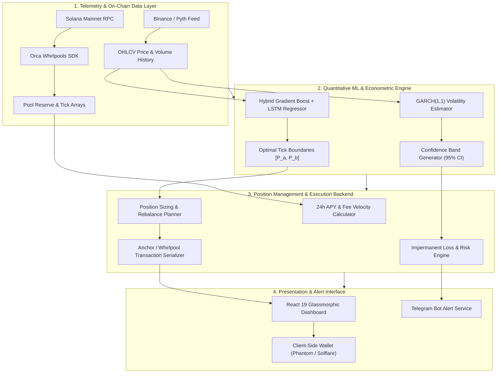

# YieldSense: AI-Powered Concentrated Liquidity Position Manager for Orca Whirlpools

[](https://opensource.org/licenses/MIT)
[](https://solana.com/)
[](https://www.orca.so/)
[](https://react.dev/)
[](https://nodejs.org/)
[](https://fastapi.tiangolo.com/)

> **Quantitative DeFi infrastructure combining machine learning range forecasting, automated position management, and real-time risk telemetry for concentrated liquidity market makers.**

| Service | Environment | Live URL | Status |
| :--- | :--- | :--- | :--- |
| **Interactive Web Application** | Firebase Hosting | [yieldsense-app.web.app](https://yieldsense-app.web.app/) |  |
| **Position Management Backend** | Node.js / Express | Local Port 3001 |  |
| **ML Volatility & Range API** | FastAPI / Python | Local Port 8000 |  |
| **Trading Aggregation Gateway** | Express / TypeScript | Local Port 3002 |  |

---

## Executive Summary

**YieldSense** is an enterprise-grade automated position management and analytics platform engineered specifically for Concentrated Liquidity Market Maker (CLMM) pools on the Solana blockchain (Orca Whirlpools). Concentrated liquidity increases capital efficiency by up to 4000x compared to traditional $x \cdot y = k$ invariant automated market makers; however, it subjects liquidity providers (LPs) to acute impermanent loss and out-of-range yield cessation when market prices shift beyond predefined tick boundaries.

YieldSense eliminates manual position adjustment and guesswork by coupling **GARCH(1,1) econometric volatility modeling**, **hybrid Gradient Boosting and LSTM price direction forecasting**, and **Orca Whirlpool SDK on-chain transaction builders**. The platform calculates mathematical yield curves across multiple fee tiers (0.01%, 0.04%, 0.30%), forecasts optimal 24-hour upper and lower price bounds, and alerts market makers before liquidity allocations experience range slippage.

---

## Market Inefficiency & Problem Statement

```
   TRADITIONAL AMM ($x \cdot y = k$)             CONCENTRATED LIQUIDITY (ORCA WHIRLPOOLS)
   +-------------------------------+             +-------------------------------+
   | Capital spread across         |             | Capital focused in narrow     |
   | $0 \to \infty$                |  =======>   | range $[P_a, P_b]$            |
   | Extremely low fee yields      |             | Up to 4000x capital density   |
   | Constant impermanent loss     |             | Risk: zero yield out-of-range |
   +-------------------------------+             +-------------------------------+
```

### Core Liquidity Provider Bottlenecks

1. **Range Exhaustion (Out-of-Range Risk):**
   - In CLMM pools, when price $P$ moves outside $[P_a, P_b]$, the position converts 100% into the depreciating asset and earns exactly zero fees until price re-enters the interval.
   - Passive LPs incur substantial opportunity costs and asymmetric downside exposure during trending market conditions.

2. **The Volatility-Spread Dilemma:**
   - Narrow price ranges yield maximum fee velocity during range-bound regimes but get liquidated/exhausted quickly during high-volatility spikes.
   - Broad ranges prevent out-of-range events but dilute fee yield to near-traditional AMM levels.

3. **Manual Execution Latency:**
   - Tracking tick movements across multiple Solana DEX pools manually requires constant on-chain monitoring and frequent manual transaction signing, resulting in suboptimal entry and exit execution.

---

## System Architecture

YieldSense coordinates four specialized services into a continuous analytics and execution pipeline:



---

## Quantitative & Mathematical Methodology

### 1. Concentrated Liquidity Tick Mathematics
For an Orca Whirlpool with lower bound price $P_a$ and upper bound price $P_b$, the virtual liquidity $L$ supported by token amounts $\Delta x$ and $\Delta y$ satisfies:

$$\Delta x = L \left( \frac{1}{\sqrt{P}} - \frac{1}{\sqrt{P_b}} \right), \quad \Delta y = L \left( \sqrt{P} - \sqrt{P_a} \right)$$

The real capital efficiency multiplier $E$ relative to a standard $x \cdot y = k$ invariant is defined as:

$$E = \frac{1}{1 - \left( \frac{P_a}{P_b} \right)^{1/4}}$$

YieldSense evaluates this multiplier across tick steps ($\text{tick\_spacing} \in \{1, 8, 64, 128\}$) to maximize fee capture per unit of committed capital.

### 2. GARCH(1,1) Volatility Modeling
Short-term conditional return variance $\sigma_t^2$ is estimated using a generalized autoregressive conditional heteroskedasticity formulation:

$$\sigma_t^2 = \omega + \alpha \epsilon_{t-1}^2 + \beta \sigma_{t-1}^2$$

- **Constraint:** $\alpha + \beta < 1$ ensuring mean-reversion stability.
- **Dynamic Band Sizing:** Position width is scaled dynamically with conditional standard deviation $\sigma_t$:
  $$[P_a, P_b] = \left[ P_t \cdot \exp(-k \cdot \sigma_t \sqrt{\Delta t}), \; P_t \cdot \exp(k \cdot \sigma_t \sqrt{\Delta t}) \right]$$
  where $k$ is optimized based on user-selected risk profile (Aggressive, Moderate, Conservative).

### 3. Impermanent Loss Formulation in Range
When the price moves from entry price $P_0$ to current price $P$, the value of the concentrated position $V(P)$ relative to a simple hold strategy $V_{\text{hold}}(P)$ within range is given by:

$$\text{IL}(P) = \frac{2 \sqrt{P/P_0} - 1 - P/P_0}{(1 - \sqrt{P_a/P_0}) + \frac{P}{P_0}(1 - \sqrt{P_0/P_b})}$$

YieldSense computes the exact breakeven duration $\tau_{\text{be}}$ where cumulative fees offset maximum projected impermanent loss:

$$\tau_{\text{be}} = \frac{|\text{IL}(P)|}{\text{Fee APR} / 365}$$

---

## Supported Pools & Fee Tiers

| Pool Pair | Tick Spacing | Fee Tier | Strategy Focus | Status |
| :--- | :---: | :---: | :--- | :--- |
| **SOL / USDC** | 1 | 0.01% | High-volume stable peg / delta hedging | Active |
| **SOL / USDC** | 8 | 0.04% | Core algorithmic market making | Active |
| **JupSOL / SOL** | 1 | 0.01% | LST arbitrage and basis compounding | Active |
| **SOL / PENGU** | 64 | 0.30% | High-volatility fee capture | Active |
| **JUP / SOL** | 64 | 0.30% | Ecosystem momentum positioning | Active |

---

## API Reference

### ML Forecasting Microservice (Port 8000)

| Endpoint | Method | Description | Sample Request | Key Response |
| :--- | :---: | :--- | :--- | :--- |
| `/health` | `GET` | Service liveness and GPU/model state | `GET /health` | `status: "healthy"` |
| `/predict/range` | `POST` | Computes optimal tick ranges and volatility | `{"pair": "SOL/USDC", "horizon_hours": 24}` | `lower_bound`, `upper_bound`, `confidence_pct` |
| `/predict/volatility` | `POST` | Returns GARCH(1,1) conditional volatility | `{"pair": "SOL/USDC"}` | `sigma_t`, `volatility_regime` |
| `/analytics/yield` | `POST` | Evaluates fee APR against projected IL | `{"pair": "SOL/USDC", "range": [180, 205]}` | `projected_apy`, `breakeven_days` |

### Position Management API (Port 3001)

| Endpoint | Method | Description | Sample Request | Key Response |
| :--- | :---: | :--- | :--- | :--- |
| `/api/pools` | `GET` | Fetches active Orca Whirlpool states | `GET /api/pools` | Array of pool objects with TVL, APR, price |
| `/api/positions` | `GET` | Retrieves user positions for connected public key | `GET /api/positions?owner=...` | Position NFTs, tick lower, tick upper, liquidity |
| `/api/positions/create-tx`| `POST` | Builds unsigned transaction for Whirlpool deposit | `{"pool": "...", "amountA": 1.5, "amountB": 300}` | `serialized_transaction` (base64) |
| `/api/alerts/subscribe` | `POST` | Enrolls user Telegram chat for range alerts | `{"chat_id": "...", "position_id": "..."}` | `subscribed: true` |

---

## Technology Stack

| Layer | Technologies |
| :--- | :--- |
| **Frontend Interface** | React 19, TypeScript, Vite, Tailwind CSS, Radix UI, Lucide Icons |
| **Backend Orchestrator** | Node.js, Express, TypeScript, WebSocket |
| **Quantitative ML** | Python 3.10+, FastAPI, NumPy, Pandas, Scikit-learn, PyTorch, ARCH |
| **Blockchain Infrastructure** | Solana Web3.js, Orca Whirlpools TypeScript SDK, Anchor Framework |
| **Real-Time Storage** | Firebase Firestore, Redis |
| **Alert Infrastructure** | Telegram Bot API, Firebase Cloud Functions |
| **Production Hosting** | Firebase Hosting (Frontend), Render / Railway (Services) |

---

## Installation & Local Development

### Prerequisites
- Node.js 18.x or 20.x
- Python 3.10+
- Rust & Cargo (if compiling Anchor contracts locally)
- Solana CLI tools (v1.18+)

### 1. Clone Repository
```bash
git clone https://github.com/Manimaran-tech/stable_yeildsense.git
cd stable_yeildsense
```

### 2. Install Dependencies
```bash
# Root and frontend dependencies
npm install
cd whirlpool-dashboard && npm install
cd ../server && npm install

# Python ML dependencies
cd ../ml-api
pip install -r requirements.txt
```

### 3. Configure Environment Variables
Create `.env` inside `server/` and `ml-api/`:
```env
# Server (.env)
PORT=3001
SOLANA_RPC_URL=https://api.mainnet-beta.solana.com
FIREBASE_PROJECT_ID=yieldsense-app
TELEGRAM_BOT_TOKEN=your_bot_token

# ML API (.env)
PORT=8000
BINANCE_API_KEY=your_key_if_applicable
```

### 4. Launch Services
```powershell
# Windows PowerShell automated orchestrator
powershell -ExecutionPolicy Bypass -File start_services.ps1
```

Or run each service individually:
```bash
# Terminal 1: Position Management Server
cd server && npm run dev

# Terminal 2: ML Volatility Service
cd ml-api && uvicorn app:app --host 0.0.0.0 --port 8000 --reload

# Terminal 3: React Dashboard
cd whirlpool-dashboard && npm run dev
```

---

## Security & Non-Custodial Architecture

- **Client-Side Key Management:** Private keys and seed phrases are never ingested, transmitted, or stored on YieldSense servers. All transactions are compiled as serialized payloads and returned to client wallets (Phantom, Solflare) for cryptographic signing.
- **Slippage Protection:** All position creation transactions enforce rigorous on-chain `slippage_tolerance` parameters to eliminate sandwich attacks and front-running on decentralized exchanges.
- **Deterministic Program Invocations:** On-chain calls interact directly with audited Orca Whirlpool protocol smart contracts on Solana mainnet.

---

## License

This project is licensed under the MIT License — see the [LICENSE](LICENSE) file for details.
Underlying Orca Whirlpools contracts and SDKs are subject to their respective licenses from Orca Management Company S.A.
